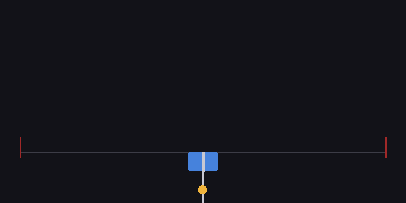
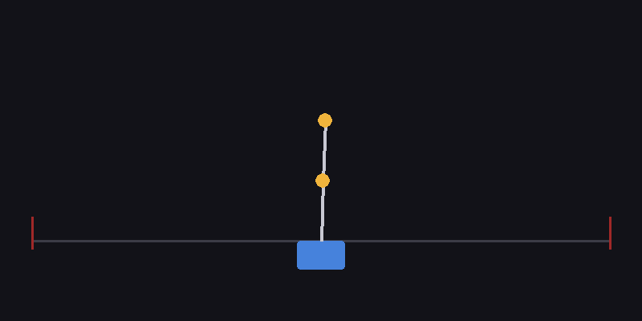

# Double Inverted Pendulum on a Cart — RL vs Classical Control



*A SAC agent swinging a double pendulum up from hanging and catching it into a
balanced equilibrium (seed 2, gSDE + 2× update ratio — best agent of the study,
100/100 successes, upright in 2.6 s mean).*


-555)

A from-first-principles study of the double inverted pendulum on a cart: the
dynamics are hand-derived in manipulator form and independently verified
against a symbolic Lagrangian, LQR provides the classical baseline, and SAC is
trained for both balance and swing-up. All results below are from strict
100-episode deterministic evaluations on CPU-only hardware.

**TL;DR**

| Task | LQR | SAC | Verdict |
|---|---|---|---|
| Balance (10 s, small perturbations) | 100% success, 499.9 return | 100 / 100 / 96% (3 seeds) | tie at this scale; LQR simpler |
| Region of attraction (±0.6 rad grid) | 17.0% | 16.3% | statistical tie — both local controllers |
| Swing-up (20 s, from hanging) | n/a (balance-only) | **100% on all 3 seeds** after optimizer tuning | RL wins the task LQR cannot attempt |

The interesting engineering story is in the swing-up optimizer study: vanilla
SAC lands 2 of 3 seeds in a partial-credit local optimum that **no reward
shaping escaped**, while pure optimizer changes (gSDE exploration + a doubled
update-to-data ratio) solved all of them within the original training budget.

---

## 1. Dynamics

Point masses `m1, m2` on massless rods (`l1, l2`) on a cart of mass `M` driven
by force `F` (|F| ≤ 20 N) along a ±2.4 m track. Angles are measured **from
upright**, positive clockwise: `θ = 0` upright, `θ = π` hanging.

Equations of motion in manipulator form, integrated with RK4 at 2 ms (10
physics substeps per 20 ms control step):

```
M(q) q̈ = f(q, q̇, F),   q = [x, θ1, θ2]  solved via np.linalg.solve — never inverted symbolically
```

**Correctness is enforced by tests, not assumed:**

| Check | Result |
|---|---|
| Hand-written EOM vs independent sympy Lagrangian derivation (100 random states, damping exercised) | agreement < 1e-9 |
| Energy drift, free evolution over 10 s (RK4, dt = 2 ms) | relative drift < 1e-4 |
| Horizontal momentum (F = 0, no damping) | conserved < 1e-6 |
| Equilibria / hanging stability / upright instability | verified |
| Numba-jitted vs pure-NumPy integrator | bit-agreement < 1e-12 |

`@numba.njit(cache=True)` on `accel` / `rk4_step` (parameters passed as a
flat float64 array — numba can't consume dataclasses) yields ~11× over NumPy,
≈ 37k control steps/s per core. Benchmark: `uv run python scripts/bench_dynamics.py`.

## 2. MDP

| | |
|---|---|
| Action | `Box(-1, 1)`, scaled to `F ∈ [-20, 20] N`, zero-order hold for 20 ms |
| Observation (9-d) | `[x, sin θ1, cos θ1, sin θ2, cos θ2, ẋ, θ̇1, θ̇2, x / track_limit]` — sin/cos encoding avoids wrap discontinuity |
| Reward (swing-up) | `(cos θ1 + cos θ2)/2 − 0.01 x² − 0.001(θ̇1² + θ̇2²) − 0.001 a²`, −100 terminal on track exit |
| Reward (balance) | +1 per step alive, same penalties |
| Termination | \|x\| > 2.4 m (both); \|θ\| > 0.5 rad (balance only). Time limit truncates, never terminates |
| Init | balance: θ ~ U(−0.1, 0.1); swing-up: θ ≈ π ± 0.05 |
| Optional | ±20% domain randomisation of `m1, m2, l1, l2` per reset; Gaussian obs noise |

`check_env`-clean; deterministic under fixed seeds; pygame renderer with
`rgb_array` support drives the GIFs.

## 3. Controllers

**LQR (classical baseline).** Dynamics linearised around upright by central
finite differences (cross-checked to 1e-5 against the symbolic Jacobian);
controllability rank 6 verified; `scipy.linalg.solve_continuous_are` with
`Q = diag(1, 50, 50, 1, 1, 1)`, `R = 0.1`; force clipped to ±20 N. Balance-only
by construction. Closed-loop eigenvalues all in the open left half-plane.

**SAC.** `MlpPolicy [256, 256]`, 8 envs in `SubprocVecEnv`, `VecNormalize`
(obs + reward; stats saved and frozen at evaluation), `EvalCallback` every 20k
steps (10 episodes, best checkpoint kept), TensorBoard logging. CPU only — on
Apple Silicon the GPU (MPS) transfer overhead loses to CPU for 256×256 MLPs.
Balance: 200k steps ≈ 7 min/seed. Swing-up: 2M steps ≈ 25 min/seed.
`torch.set_num_threads(2)` so concurrent seed runs don't contend.

## 4. Results

All evaluations: 100 episodes, deterministic policy, success = both
\|θ\| < 0.1 rad sustained for 2 s **and** no early termination.

### 4.1 Balance

| Controller | Success | Mean return | Effort ∑F²dt |
|---|---|---|---|
| LQR | 100% | 499.9 | 17.3 |
| SAC seed 0 / 1 / 2 | 100% / 100% / 96% | 499.6 / 499.7 / 483.3 | — |



**Region of attraction** (`roa_balance.png`): LQR recovers 17.0% of a 21×21
grid over (θ1, θ2) ∈ [−0.6, 0.6]² at zero velocity vs SAC's 16.3% — a tie.
The double pendulum is simply not stabilisable from most of that grid under a
20 N budget; both controllers are inherently local.

**Robustness** (`robustness_*.png`): LQR and nominal SAC both hold 90–100%
success across `m2`, `l2` at 0.5×–1.5× nominal. The single domain-randomised
seed never falls (0/10 early terminations at the extremes) but hovers just
outside the strict 0.1 rad window at 0.5× `m2` and ≥ 1.3× `l2` — randomisation
traded steady-state tightness for never falling (n = 1; don't over-read).

**Observation noise**: both controllers are perfect at σ = 0.01 and both fail
at σ = 0.05. With `R = 0.1` the LQR gains are aggressive, so 0.05 rad-scale
noise injects several newtons of white force jitter — measured wobble to 0.6
rad. SAC, trained noise-free, inherits the same sensitivity. Fixing this
needs noise injected during training (or a larger `R`); noted as future work.

### 4.2 Swing-up — and the optimizer study

Vanilla SAC (2M steps, 3 seeds) solved swing-up on 1 of 3 seeds at 100%.
The other two converged to a **partial-credit local optimum**: hold the top
rod upright while the bottom rod keeps rotating — ~0.65 reward/step forever,
never holding both rods still.

Ten controlled retraining runs later (standard 20 s task, strict metric):

| Variant (2M steps unless noted) | Seed 0 | Seed 2 |
|---|---|---|
| Vanilla SAC (baseline) | 0% | 0% |
| 2000-step episodes + velocity penalty 0.001 → 0.0002 | 0% | 0% |
| Velocity penalty 0.004 (punish the wag directly) | — | 0% |
| Fine-tune from balance policy, 1.5M | — | 0% |
| `target_entropy = 0` | **100%** | 0% |
| **gSDE** (`sde_sample_freq = 10`) | **100%** | 0% (642 return, still climbing at cutoff) |
| gSDE, 3M steps | — | **100%** (904) |
| gSDE + `target_entropy = 0.5` | — | 0% (185) |
| **gSDE + `gradient_steps = 2`** | — | **100% — 933, best agent** |
| gSDE + `target_entropy = 0.5` + `gradient_steps = 2` | — | 0% (528) |

Final, all seeds at 100%:

| Seed | Optimizer | Success | Return | Time to upright |
|---|---|---|---|---|
| 0 | SAC + gSDE | 100% | 896 | 3.58 s |
| 1 | SAC (vanilla) | 100% | 890 | 3.42 s |
| 2 | SAC + gSDE + `gradient_steps = 2` | 100% | **933** | **2.58 s** |

**Interpretation.** The failure mode was *exploratory*, not a reward-design
bug: every reward-shaping intervention failed (lowering the velocity penalty
made the wag *more* profitable; punishing it just lowered all returns), while
two optimizer-level changes resolved it. gSDE's temporally-correlated noise
can sustain the coordinated, energetic pumping the swing-up maneuver needs —
uncorrelated Gaussian action noise cannot. The doubled update-to-data ratio
(`gradient_steps = 2`) accelerates value propagation so the critic prices the
escape from the wag optimum before the policy commits to it. Excess entropy
(`target_entropy = 0.5`) is actively harmful — the policy never commits. One
practical footnote: `EvalCallback`'s `best_model` can be a cliff-edge
checkpoint; the 3M-run's *final* model evaluated 904 vs its mid-training
"best" at 52% strict success — always report final-model evaluations.

Plots: `results/plots/` (`learning_curves_*.png`, `roa_balance.png`,
`traces_*.png`, `robustness_*.png`). GIFs per seed: `results/videos/`.

## 5. Reproducing

```bash
uv sync                                   # or: python3.12 -m venv .venv && pip install -r requirements.txt
uv run pytest                             # 24 tests: dynamics, env, LQR
uv run python scripts/bench_dynamics.py   # numba vs numpy throughput

# Balance: 3 seeds in parallel (~7 min each; caffeinate keeps the Mac awake)
scripts/run_seeds.sh balance

# Swing-up with the winning optimizer configs (~25 min/seed)
caffeinate -i uv run python scripts/train_sac.py --task swingup --seed 0 --use-sde
caffeinate -i uv run python scripts/train_sac.py --task swingup --seed 1
caffeinate -i uv run python scripts/train_sac.py --task swingup --seed 2 --use-sde --gradient-steps 2

# Evaluation / analysis
uv run python scripts/evaluate.py --controller results/sac/swingup_seed2_sdeg2 --task swingup --episodes 100 --video
uv run python scripts/compare.py --sac-swingup results/sac/swingup_seed2_sdeg2
uv run python scripts/robustness.py
uv run tensorboard --logdir results/tb
```

Training flags: `--timesteps --seed --randomize --use-sde --target-entropy
--gradient-steps --velocity-penalty --episode-steps --init-from --out`.
Seeds are recorded in artifact paths; `evaluate.py` writes JSON summaries to
`results/eval/`. Models, GIFs, logs are gitignored; plots and `docs/` are
committed.

## 6. Notes & deviations

- The spec tree calls the project
  `double-pendulum-rl` (internal structure matches).
- Dependencies via uv (`pyproject.toml` + `uv.lock`); `requirements.txt` kept
  in sync for pip users.
- `src/env.py` accepts two optional kwargs beyond the spec
  (`reward_weights`, `max_episode_steps`) — both used by the swing-up study;
  defaults implement the spec exactly.
- Success metric is uniform across all scripts (see §4); angle wrap-around at
  2πk is handled (policies that swing up with net rotations settle at
  θ = 2πk, which naive |θ| checks would mis-score).

Spec: `PROJECT.md` (untracked by request).
